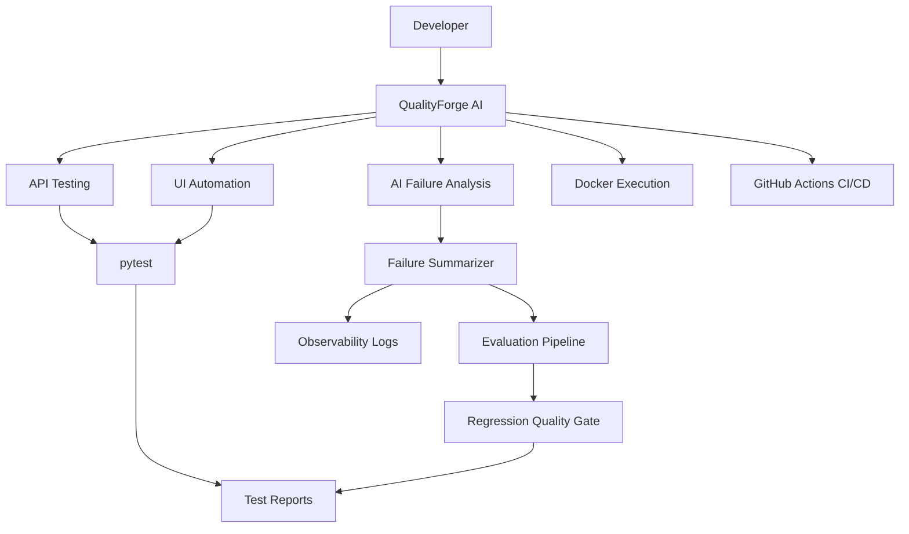

# QualityForge AI

**AI-Assisted Software Quality Engineering & Test Automation Platform**

QualityForge AI is a Python-based quality engineering project that combines API testing, browser automation, CI/CD integration, containerized test execution, test reporting, and AI-assisted failure analysis.

The project demonstrates how automated testing and evaluation workflows can help engineering teams identify defects, analyze failures, monitor execution, and establish quality gates before software releases.

## 1. Project Overview

Modern software teams need reliable and repeatable testing processes.

QualityForge AI brings together:

- API automation using Python and pytest.
- Browser automation using Playwright.
- Cross-browser testing.
- JSON schema validation.
- Docker-based test execution.
- GitHub Actions CI/CD.
- Structured test reporting.
- AI-assisted test failure analysis.
- Evaluation regression gates.
- Sensitive-data redaction.
- Structured execution observability.

## 2. Project Architecture



## 3. Technology Stack

| Category | Technology |
|---|---|
| Programming language | Python |
| API testing | Requests, pytest |
| UI automation | Playwright |
| JSON validation | jsonschema |
| Configuration | python-dotenv |
| Test reporting | pytest-html, JUnit XML |
| AI-assisted analysis | Python rule-based prototype |
| Evaluation | Custom evaluation pipeline |
| Observability | Structured JSON logging |
| Version control | Git, GitHub |
| CI/CD | GitHub Actions |
| Containerization | Docker |

## 4. Project Structure

```text
QualityForge-AI/
├── .github/
│   └── workflows/
│       └── tests.yaml
├── docs/
│   ├── ai_feature_spec.md
│   ├── ai_versioning.md
│   ├── prompt_examples.md
│   ├── security-and-privacy.md
│   └── ...
├── pages/
├── reports/
├── scripts/
│   ├── evaluate_ai_summaries.py
│   ├── failure_analyzer.py
│   ├── measure_ai_efficiency.py
│   └── report_metrics.py
├── src/
│   ├── ai_failure_summarizer.py
│   ├── api_client.py
│   ├── config.py
│   ├── observability.py
│   └── validation.py
├── tests/
│   ├── api/
│   ├── ui/
│   ├── test_ai_failure_summarizer.py
│   ├── test_observability.py
│   └── ...
├── test_data/
│   ├── schemas/
│   └── ai_evaluation_cases.json
├── .dockerignore
├── .gitignore
├── Dockerfile
├── pytest.ini
├── requirements.txt
└── README.md
```

## 5. Prerequisites

- Python 3.12
- Git
- Docker Desktop
- Windows, Linux, or macOS

## 6. Local Setup

Clone the repository:

```bash
git clone https://github.com/Rahul183269/QualityForge-AI.git
cd QualityForge-AI
```

Create a virtual environment:

```bash
python -m venv .venv
```

Activate it on Windows PowerShell:

```powershell
.\.venv\Scripts\Activate.ps1
```

Install dependencies:

```bash
python -m pip install --upgrade pip
pip install -r requirements.txt
```

Install Playwright browsers:

```bash
python -m playwright install chromium firefox
```

## 7. Running Automated Tests

Run the complete test suite:

```bash
python -m pytest -v
```

Generate an HTML report:

```bash
python -m pytest -v --html=reports/test-report.html --self-contained-html
```

Generate a JUnit XML report:

```bash
python -m pytest -v --junitxml=reports/junit.xml
```

## 8. AI-Assisted Failure Analysis

QualityForge AI includes a prototype that analyzes test failure messages and generates structured diagnostic information.

Current capabilities:

- Failure classification.
- Failure summaries.
- Evidence extraction.
- Possible root-cause suggestions.
- Recommended investigation steps.
- Confidence and limitation reporting.
- Sensitive-data redaction.
- Long-input handling.

**Implementation note:** The current summarizer is a deterministic, rule-based prototype. It does not yet connect to an external LLM provider.

## 9. AI Evaluation and Regression Testing

The evaluation pipeline validates the failure summarizer against a versioned evaluation dataset.

Run the evaluation:

```bash
python scripts/evaluate_ai_summaries.py
```

Current evaluation cases cover:

- Assertion failures.
- Network failures.
- Environment failures.
- Setup failures.
- Unknown failures.
- Sensitive information.
- Empty input.
- Long error messages.

The evaluation records:

- Unique run ID.
- UTC execution timestamp.
- Model/provider version.
- Prompt version.
- Dataset version.
- Evaluator version.
- Individual case results.
- Overall regression gate status.

The latest evaluation report is generated at:

```text
reports/ai_evaluation_latest.json
```

## 10. Observability

The project includes structured execution logging.

Recorded information includes:

- Execution ID.
- Event name.
- Execution duration.
- Success or failure result.
- Test name.
- Failure category.
- Sanitized error details.

Logs are written in JSON Lines format:

```text
reports/observability.jsonl
```

This supports investigation and traceability of test execution.

## 11. Docker Execution

Build the Docker image:

```powershell
docker build -t qualityforge-ai:latest .
```

Run the test suite:

```powershell
docker run --rm qualityforge-ai:latest
```

Persist reports on the local machine:

```powershell
docker run --rm -v "${PWD}/reports:/app/reports" qualityforge-ai:latest
```

## 12. CI/CD Pipeline

QualityForge AI uses GitHub Actions for automated test execution.

The workflow supports:

- Pushes to the main branch.
- Pull requests targeting the main branch.

Pipeline stages:

1. Check out the repository.
2. Configure Python.
3. Install dependencies.
4. Install Playwright browsers.
5. Execute automated tests.
6. Generate test reports.
7. Upload reports as GitHub Actions artifacts.

Artifact name: `junit-test-results`.

## 13. Latest Verified Test Results

<details>
<summary>Local test execution</summary>

| Metric | Result |
|---|---:|
| Total tests | 50 |
| Passed | 50 |
| Failed | 0 |

</details>

<details>
<summary>AI evaluation execution</summary>

| Metric | Result |
|---|---:|
| Evaluation cases | 8 |
| Passed | 8 |
| Failed | 0 |
| Regression gate | PASSED |

</details>

*These results represent the latest recorded local verification. They are not a claim that every Docker or CI execution has independently passed with the same test count.*

## 14. Security and Privacy

The project implements basic sensitive-data redaction for:

- API keys.
- Passwords.
- Tokens and secrets.
- Bearer authentication tokens.
- Email addresses.

Regex-based redaction has limitations and cannot guarantee detection of every possible secret format. Production systems require additional secret-scanning controls, access restrictions, and secure log storage.

## 15. Current Limitations and Future Enhancements

- External LLM integration.
- Automated prompt version management.
- Persistent historical evaluation reports.
- Advanced flaky-test detection.
- Test execution analytics dashboards.
- AI-assisted test generation.
- Advanced quality gates.
- MLOps and LLMOps monitoring and evaluation.

## 16. Learning Outcomes

This project demonstrates practical experience in:

- Python test automation.
- API and UI testing.
- Cross-browser validation.
- Test framework development.
- CI/CD engineering.
- Docker and containerization.
- Test reporting and metrics.
- AI-assisted quality engineering.
- LLMOps evaluation concepts.
- Security and observability fundamentals.

---

**Project:** QualityForge AI
**Repository:** https:/githubcom/Rahul183269/QualityForge-AI
**Primary language:** Python